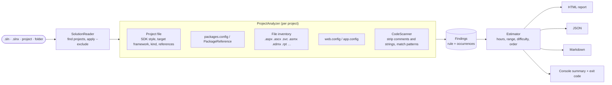
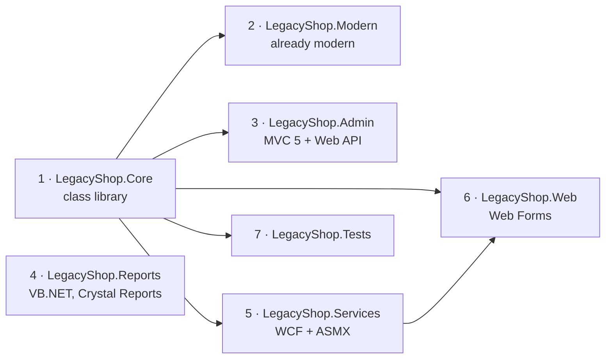

# dotnet-legacy-scan

[](https://github.com/dejanciev-dev/dotnet-legacy-scan/actions/workflows/ci.yml)
[](LICENSE)

**.NET Framework → modern .NET migration readiness scanner.**

Point it at a solution and get a report a CTO can read: what blocks the migration (Web Forms, WCF, ASMX, Membership, Remoting, BinaryFormatter, Crystal Reports…), a rough effort range, and the order to migrate projects in.

- **Local and read-only:** nothing leaves the machine, nothing in the solution is changed
- **Zero dependencies:** a single `dotnet` tool, works offline
- **C# and VB.NET:** `.sln`, `.slnx`, a single `.csproj`/`.vbproj`, or a folder
- **Three outputs:** a self-contained HTML report (prints to PDF), JSON for tooling, a Markdown summary for pull requests and CI


<sub>The report for [`samples/LegacyShop`](samples/LegacyShop): full [HTML](samples/sample-report.html) (download and open it), [JSON](samples/sample-report.json), [Markdown](samples/sample-report.md).</sub>

## Contents

- [Quick start](#quick-start)
- [Options](#options)
- [Using it in CI](#using-it-in-ci)
- [How it works](#how-it-works)
- [Rules](#rules)
- [How the estimate is calculated](#how-the-estimate-is-calculated)
- [Recommended migration order](#recommended-migration-order)
- [Output formats and exit codes](#output-formats-and-exit-codes)
- [Privacy](#privacy)
- [Limitations](#limitations)
- [Project structure](#project-structure)
- [Development and contributing](#development-and-contributing)

## Quick start

Requires the .NET 10 runtime (or newer).

```bash
dotnet tool install -g dotnet-legacy-scan
dotnet legacy-scan path/to/MySolution.sln

# one-off run without installing (.NET 10 SDK)
dnx dotnet-legacy-scan path/to/MySolution.sln
```

The console shows a summary and writes `legacy-scan-report.html`:

```text
  Projects:     7 (1 already modern)
  Code:         100 lines
  Findings:     6 blocker · 15 major · 20 minor
  Difficulty:   High (complexity 79/100)
  Effort:       42–88 developer days (rough estimate)

  Report:       /work/legacy-scan-report.html
```

## Options

| Option | Description |
|---|---|
| `<path>` | `.sln`, `.slnx`, `.csproj`, `.vbproj` or a folder. A folder with exactly one solution uses that solution; otherwise every project below the folder is scanned |
| `-o, --out <file>` | HTML report path (default `legacy-scan-report.html`) |
| `--json <file>` | Also write JSON |
| `--md <file>` | Also write a short Markdown summary (for pull requests or the CI job summary) |
| `--exclude <pattern>` | Skip projects whose name or relative path matches (`*`, `?`); repeatable. The report lists what was excluded |
| `--no-snippets` | Leave source code lines out of the HTML/JSON, so the report can be shared outside the team |
| `--brand <text>` / `--contact <text>` | Footer call-to-action (your company + email/URL) |
| `--hours-per-day <n>` | Productive hours per developer day (default 6) |
| `--fail-on <minor\|major\|blocker>` | Exit code 2 when a finding of that severity or worse exists (CI gate) |
| `-q, --quiet` | No console summary |
| `--version` | Print the version |

## Using it in CI

```yaml
- run: dotnet tool install -g dotnet-legacy-scan
- run: dotnet legacy-scan MySolution.sln -o legacy-scan.html --md "$GITHUB_STEP_SUMMARY" --exclude "*.Tests"
- uses: actions/upload-artifact@v6
  with:
    name: legacy-scan
    path: legacy-scan.html
```

The Markdown summary appears on the workflow run page. Add `--fail-on blocker` to stop blockers (for example a new Web Forms page) from coming back once they are gone.

## How it works

The scan is pattern based: it reads project files, NuGet references, configuration and file types, and matches source code with regular expressions after comments and string literals are blanked out. There is no compilation and no Roslyn, which keeps the tool dependency-free and fast, at the cost of the [limitations](#limitations) below.



### 1. Finding projects (`SolutionReader`)

- **`.sln`:** project lines are parsed directly (no MSBuild). Backslash paths work on Linux and macOS. Solution folders are skipped; **Web Site projects** (no project file) produce a warning because they cannot be analyzed.
- **`.slnx`:** read as XML.
- **Folder:** if it holds exactly one solution, that solution is used; otherwise all `.csproj`/`.vbproj` below it are scanned. A folder that looks like a Web Site (`App_Code`, `.aspx`, no project) produces a warning.
- Skipped everywhere: `bin`, `obj`, `packages`, `node_modules`, `.git`, `.vs`, `.idea`, `TestResults`, `artifacts`, and symlinks/junctions (they can loop).
- Projects with the same name get their path appended, so the report stays unambiguous. Two projects in one folder produce a warning, because their files are counted for both.

### 2. Analyzing each project (`ProjectAnalyzer`)

**Project file.** SDK style or legacy format, target framework(s) (from the project or the nearest `Directory.Build.props`), assembly and project references.

A project counts as **already modern** when it is SDK style and at least one target is `net5.0`+, `netcoreapp*` or `netstandard*` (so `net48;net10.0` counts). For modern projects only the findings that still break at runtime are kept: BinaryFormatter and Thread.Abort.

**Project kind.** The first match wins:

| # | Kind | Detected by |
|---|---|---|
| 1 | ASP.NET Web Forms | any `.aspx` page |
| 2 | Tests | test project type GUID, MSTest, NUnit or xUnit reference (checked early because test projects often reference MVC or Web API) |
| 3 | ASP.NET MVC | `System.Web.Mvc` / `Microsoft.AspNet.Mvc` |
| 4 | ASP.NET Web API | `System.Web.Http` / `Microsoft.AspNet.WebApi` |
| 5 | WCF service | `.svc` files or the WCF project type GUID |
| 6 | ASP.NET Web Forms | web application project type GUID |
| 7 | WPF / WinForms | WPF type GUID or reference, `UseWPF`; `System.Windows.Forms` + `WinExe`, `UseWindowsForms` |
| 8 | Console / Class library | `OutputType` |

**Files.** The project folder is walked (not the `<Compile>` items), stopping at nested project folders:

| Files | Used for |
|---|---|
| `.cs`, `.vb` | Code patterns, lines of code |
| `.aspx`, `.ascx`, `.master` | Web Forms rules; each page lists its server controls, UpdatePanels and code-behind size |
| `.svc`, `.asmx` | WCF hosting, ASMX services |
| `.svcmap`, `ConnectedService.json`, `Reference.map`, `.discomap` | WCF / ASMX client references |
| `.cshtml`, `.vbhtml` | MVC views |
| `.edmx` | EF designer models |
| `.xamlx`, workflow `.xaml` | Workflow Foundation |
| `.rpt`, `.rdlc` | Crystal Reports / ReportViewer reports |
| `Global.asax` | Application events |
| `Web.config`, `App.config` | Configuration (transforms such as `Web.Debug.config` are ignored) |

**Configuration.** Only the base `web.config`/`app.config`:

- `membership`, `roleManager`, `profile` and `<authentication mode="Forms">` under `system.web`. Forms authentication without a Membership/Roles/Profile provider is the smaller SEC003, not the SEC001 blocker.
- `sessionState` with `SQLServer`, `StateServer` or `Custom` mode.
- `system.serviceModel` services (self-hosted WCF) and client endpoints.
- Custom HTTP modules and handlers (`System.*` types are ignored; a type registered for both the classic and integrated pipeline counts once).

**Packages.** `packages.config`, `PackageReference` and assembly references are matched against a list of known packages. Each package *family* is charged once, and a family is skipped when the app-model rule already includes it (e.g. `Microsoft.AspNet.Mvc` is part of APP003). Packages that already support modern .NET, such as `Microsoft.AspNet.WebApi.Client`, are not flagged.

### 3. Scanning code (`CodeScanner`)

Before matching, comments and string literals are replaced with spaces, keeping line numbers intact, so `// uses BinaryFormatter` or `"HttpContext.Current"` in a message do not count:

- **C#:** `//` and `/* */` comments; regular, verbatim (`@`), interpolated (`$`) and raw (`"""…"""`, any number of quotes and `$`) strings; char literals. Code inside interpolation holes (`$"{HttpContext.Current.User}"`) is still scanned.
- **VB.NET:** `'` and `REM` comments and strings, including multi-line strings.

Generated code (`*.Designer.cs`, `*.g.cs`, `Service References`, `Web References`, `Connected Services`) counts towards lines of code but is not scanned, so one service reference is not counted several times.

## Rules

37 rules. Hours are heuristics for an experienced .NET developer, before testing (see the [estimate](#how-the-estimate-is-calculated)). The guidance shown in the report for each rule is in [`Rules.cs`](src/LegacyScan/Rules.cs).

| ID | Rule | Severity | Base h | Per occurrence h |
|---|---|---|---:|---:|
| APP001 | ASP.NET Web Forms pages | Blocker | 16 | 6 |
| APP002 | Web Forms user controls / master pages | Blocker | 0 | 3 |
| APP003 | ASP.NET MVC 5 (System.Web.Mvc) | Major | 12 | 1.5 |
| APP004 | Razor views (MVC 5) | Minor | 0 | 0.5 |
| APP005 | ASP.NET Web API 2 (System.Web.Http) | Major | 8 | 1 |
| APP006 | Global.asax application events | Major | 4 | 0 |
| APP007 | Custom IHttpModule / IHttpHandler | Major | 0 | 4 |
| APP008 | WCF service hosting (.svc / system.serviceModel services) | Blocker | 8 | 8 |
| APP009 | WCF client / service references | Major | 2 | 3 |
| APP010 | ASMX web services | Blocker | 4 | 6 |
| APP011 | Windows Workflow Foundation ¹ | Blocker | 24 | 8 |
| APP012 | Desktop UI (WinForms / WPF) | Minor | 8 | 0 |
| CODE001 | HttpContext.Current (static access) | Major | 0 | 0.5 |
| CODE002 | System.Web used in a non-web library | Major | 2 | 0.5 |
| CODE003 | BinaryFormatter / NetDataContractSerializer | Major | 2 | 2 |
| CODE004 | .NET Remoting / AppDomain creation | Blocker | 8 | 4 |
| CODE005 | Thread.Abort / Suspend / Resume | Major | 0 | 2 |
| CODE006 | System.EnterpriseServices (COM+) ¹ | Blocker | 16 | 4 |
| CODE007 | Code Access Security (CAS) APIs | Minor | 0 | 0.25 |
| CODE008 | WebClient / HttpWebRequest (obsolete) | Minor | 0 | 0.5 |
| CODE009 | ConfigurationManager / web.config appSettings | Minor | 1 | 0.1 |
| CODE010 | Windows-only APIs (Registry, System.Drawing, EventLog, WMI) | Info | 0 | 0.1 |
| CODE011 | HttpRuntime.Cache / System.Web.Caching | Minor | 0 | 0.5 |
| CODE012 | Server.MapPath / HostingEnvironment | Minor | 0 | 0.25 |
| DATA001 | Entity Framework EDMX model (database-first designer) | Major | 4 | 8 |
| DATA002 | Entity Framework 6 | Minor | 2 | 0 |
| DATA003 | System.Data.SqlClient | Minor | 0 | 0.1 |
| PKG001 | NuGet package not supported on modern .NET (needs replacement) | Major | 0 | 3 |
| PKG002 | NuGet package needs a major upgrade or swap to its ASP.NET Core variant | Minor | 0 | 1 |
| PRJ001 | Legacy (non-SDK) project format | Minor | 2 | 0 |
| PRJ002 | packages.config NuGet format | Minor | 1 | 0 |
| PRJ003 | Targets an old .NET Framework version (< 4.7.2) | Minor | 2 | 0 |
| RPT001 | Crystal Reports / ReportViewer ¹ | Blocker | 16 | 4 |
| SEC001 | ASP.NET Membership / Forms Authentication / Roles ¹ | Blocker | 24 | 0 |
| SEC002 | ASP.NET Identity 2 / OWIN auth ¹ | Major | 12 | 0 |
| SEC003 | Forms Authentication with custom login (no Membership provider) ¹ | Major | 6 | 0 |
| WEB001 | ASP.NET Session state (usage or out-of-process mode) | Major | 6 | 0.25 |

¹ Solution-wide: the base hours are charged once per solution (moving users to Identity or replacing the reporting platform happens once), the per-occurrence hours in every project.

**Severities.** *Blocker*: does not exist on modern .NET, needs a rewrite or a replacement technology. *Major*: significant rework. *Minor*: mechanical change. *Info*: only matters for Linux or containers.

## How the estimate is calculated

```text
finding hours = base hours + per-occurrence hours × max(1, occurrences)
project hours = Σ finding hours + 3 h                   (the 3 h only for projects not yet on modern .NET)
total hours   = Σ project hours × 1.30                  (+30 % regression testing and stabilisation)
range         = total × 0.75  …  total × 1.6            → developer days at --hours-per-day (default 6), rounded up
```

**Worked example** with the sample solution: the Web Forms project has 3 pages (APP001: 16 + 6 × 3 = 34 h), Membership (SEC001: 24 h), 2 controls/master pages (6 h), WCF client references (8 h), Session usage (7 h) and smaller items, 96.8 h in total including the 3 h project base. All seven projects add up to 253.1 h, which is 329 h with testing, so the range is 247–526 h, or **42–88 developer days**.

**Difficulty** comes from the total hours (after testing, before the range):

| Total hours | Difficulty |
|---|---|
| 0 | None |
| up to 80, and no blocker | Low |
| up to 320 | Medium |
| up to 1,200 | High |
| more | Very high |

**Complexity score** (0–100) = 22 × log₁₀(1 + total hours) + 4 × number of distinct blocker rules. The sample scores 79.

The numbers are a starting point for planning, not a quote: UI redesign, new features, infrastructure and deployment work are not included, and the heuristics are not yet calibrated against real migrations. The per-project "Base effort" column in the report is before the testing overhead and the range.

## Recommended migration order

Projects are ordered **dependencies first** (topological sort over project references), so shared libraries are moved, multi-targeting `net48;net10.0`, while the old application keeps running on them. Among projects that are ready at the same time, the order is: non-test before test projects, lower worst severity first, fewer hours first, then by name. Circular references are listed at the end and marked.

For the sample solution:



An arrow means "is used by". Once Core is done, Modern (no issues), Admin (worst finding Major), Reports and Services (both with blockers) are all ready; Reports comes before Services because it has fewer hours (29 h vs 39 h). Web waits for Services, and the tests come last.

## Output formats and exit codes

| Output | Contents |
|---|---|
| **HTML** (`-o`) | Summary cards, "What makes this migration hard" (blockers with guidance), migration order with a recommendation per project, projects table, findings by project with file and line, and how the estimate is made. One self-contained file: no scripts, no external resources, light and dark mode, prints to PDF with all findings expanded |
| **JSON** (`--json`) | The same data for tooling, schema `dotnet-legacy-scan/v1` (see below) |
| **Markdown** (`--md`) | Headline table, blockers and the projects in migration order, for pull requests and `$GITHUB_STEP_SUMMARY` |

JSON outline (from [`samples/sample-report.json`](samples/sample-report.json)):

```json
{
  "schema": "dotnet-legacy-scan/v1",
  "toolVersion": "0.1.0",
  "summary": { "projects": 7, "blockers": 6, "major": 15, "minor": 20, "difficulty": "High",
               "complexityScore": 79, "estimatedHoursLow": 247, "estimatedHoursHigh": 526, "hoursPerDay": 6 },
  "migrationOrder": ["LegacyShop.Core", "LegacyShop.Modern", "…"],
  "warnings": [],
  "projects": [{
    "name": "LegacyShop.Web", "kind": "webForms", "targetFramework": "net472", "isModernAlready": false,
    "estimatedHours": 96.8, "recommendedTarget": "New ASP.NET Core app (Blazor or Razor Pages)…",
    "findings": [{
      "id": "APP001", "severity": "blocker", "count": 3, "estimatedHours": 34, "guidance": "…",
      "occurrences": [{ "file": "Cart.aspx", "line": 1, "snippet": "Cart.aspx · 6 server controls · 1 UpdatePanel · 13 lines code-behind" }]
    }]
  }]
}
```

| Exit code | Meaning |
|---|---|
| 0 | Report written |
| 1 | Error: bad arguments, unreadable input, or no project could be analyzed (no report is written in that case) |
| 2 | Report written, and a finding at or above `--fail-on` exists |

## Privacy

- The scan runs locally and never opens a network connection.
- Nothing in the scanned solution is written; only the report files you ask for.
- Reports contain project names, relative file paths, package names and, unless `--no-snippets` is used, the matching lines of source code (up to 160 characters each). The JSON also contains the absolute path of the scanned input.

## Limitations

- **Pattern based, not semantic.** Regular expressions on stripped source can miss or over-count. For example `Thread.Abort` is only found on receivers named like a thread (`_workerThread.Abort()`), to avoid matching `HttpWebRequest.Abort()`.
- **Uncalibrated estimates.** The hours are expert heuristics, not data from real migrations yet.
- **Folders, not compile items.** All files in the project folder are scanned, including files excluded from the build. Two projects sharing a folder are both charged for its files (a warning says so).
- **Not analyzed:** Web Site projects (warned), code inside `#if` branches is scanned like any other code, VB XML literals that contain an apostrophe, MSBuild properties beyond `Directory.Build.props`.
- **No NuGet lookup:** the tool does not check whether a newer version of a package supports modern .NET.

False positives and misses are the most useful feedback: please [open an issue](https://github.com/dejanciev-dev/dotnet-legacy-scan/issues) with a minimal sample.

## Project structure

```text
src/LegacyScan/
  Program.cs          CLI: options, console summary, exit codes
  Scanner.cs          Orchestration: find projects, --exclude, analyze, unique names, estimate
  SolutionReader.cs   .sln / .slnx / project / folder discovery
  ProjectAnalyzer.cs  Project file, kind, packages, file inventory, config, recommendation
  CodeScanner.cs      Comment/string stripping (C#, VB) and code patterns
  Rules.cs            Rule catalogue and known packages
  Estimator.cs        Hours, range, difficulty, complexity score, migration order
  HtmlReport.cs       Self-contained HTML report
  JsonReport.cs       JSON report (schema dotnet-legacy-scan/v1)
  MarkdownReport.cs   Markdown summary
  Model.cs            Rule, Finding, Occurrence, ProjectReport, ScanReport, ReportOptions
  PACKAGE.md          Short README shown on nuget.org (no diagrams, absolute links)
tests/LegacyScan.Tests/   Dependency-free test runner (47 tests)
samples/LegacyShop/       Fake legacy solution used by the tests and the sample reports
```

## Development and contributing

```bash
dotnet build LegacyScan.slnx
dotnet run --project tests/LegacyScan.Tests     # 47 tests against samples/LegacyShop and temporary fixtures
dotnet run --project src/LegacyScan -- samples/LegacyShop/LegacyShop.sln -o out.html --json out.json --md out.md
dotnet pack src/LegacyScan -c Release           # → nupkg/dotnet-legacy-scan.<version>.nupkg
```

The tool has no NuGet dependencies, and the tests use a plain console runner, so everything builds offline. It targets `net10.0` (the current LTS) with `RollForward=Major`, so it also runs on newer runtimes; .NET 8 and 9 reach end of support on 10 November 2026 and are not targeted.

**Adding a rule:**

1. Add a `Rule` to [`Rules.cs`](src/LegacyScan/Rules.cs): ID, title, severity, base and per-occurrence hours, guidance, and `SolutionWide: true` if the base cost is a one-off for the whole solution.
2. Detect it in one of four places: a regex in `CodeScanner.Patterns`, a file type in `ProjectAnalyzer.Walk`, a config element in `ProjectAnalyzer.AnalyzeConfig`, or an entry in `Rules.KnownPackages`.
3. Add a test in [`tests/LegacyScan.Tests/Program.cs`](tests/LegacyScan.Tests/Program.cs). The `Fixture(path, content)` helper creates temporary projects; extend `samples/LegacyShop` only when the rule belongs in the showcase.
4. Regenerate the sample reports and update the rules table in this README.

Issues and pull requests are welcome, especially new rules and false-positive reports.

## Roadmap

- Roslyn semantic analysis (exact API usage, fewer false positives)
- NuGet API lookup: does a newer version support net8+/netstandard2.0?
- Use per-page Web Forms complexity (already shown per page) in the estimate, once calibrated
- Calibrate effort from real migrations

## Releasing

Push a tag `vX.Y.Z` (or `vX.Y.Z-beta.N` for a prerelease). CI builds, tests, packs with that version and publishes to NuGet; it needs the `NUGET_API_KEY` repository secret. A version published to NuGet cannot be reused: unlist it and release the next patch.

## License

[MIT](LICENSE)
